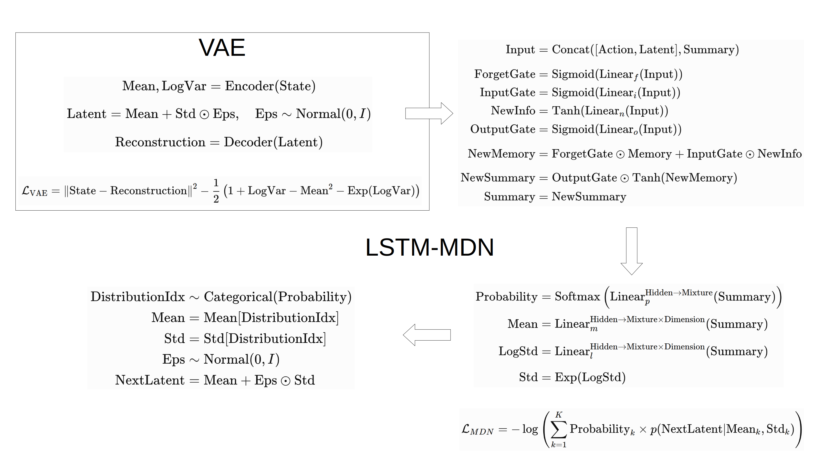
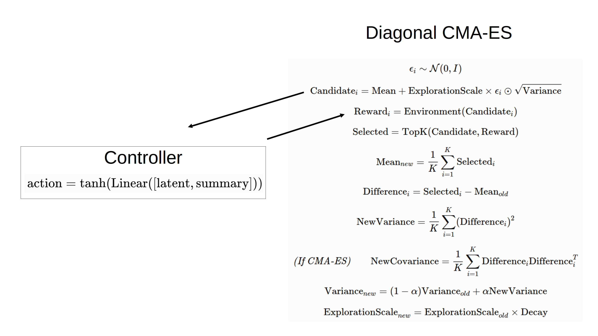

# Under-Construction
World model is a next-state predictor. If an MLP outputs next-state, this MLP is a world model. To predict more accurately, 2018 world model paper suggests a structure: VAE (Variational Autoencoder) + LSTM-MDN (Long Short-Term Memory - Mixture Density Network). VAE converts state into latent representation to extract important features, LSTM-MDN remembers past flow and uses this memory to output a distribution over possible next-states to represent future uncertainty. This structure is optimized by gradients, while the linear Controller is optimized by ES (Evolution Strategies) to demonstrate that Controller optimization can be done without gradients. After training VAE and LSTM-MDN with a reward predictor, Controller can be trained using the world model without interacting with the real environment because the world model outputs both next-state and reward, just as the real environment does. 

In Unity 3D Articulation environment, training seems to be difficult due to prediction errors in the world model and limitations of ES-based Controller. So, I use both Unity environment and the world model to train Controller. Training with my implementation proceeds without code errors, but it takes a long time and may not train well due to the limitations mentioned above. Instead of improving the code and creating a simpler environment to obtain a well-trained model, this time I focus on understanding and implementing the concepts and structure of 2018 world model, which is based on the paper [*World Models*](https://arxiv.org/pdf/1803.10122).

## World Model


### VAE Reparameterization
Directly sampling (```latent ∼ N(mean, std)```) makes gradient tracking difficult, so VAE uses ```latent = mean + std x eps``` to preserve both randomness and gradient flow. MDN uses the same formula to output NextLatent, but gradients are not needed, so it is not called reparameterization.

### VAE Loss
Reconstruction Loss: To make the reconstructed output as similar as possible to the original input.

Distribution Loss: To make the latent distribution similar to N(0,I), so that nearby points can represent similar or mixed data. Mean is pushed toward 0, and LogVar is pushed toward 0 as well. This makes Var 1 and Std 1, resulting in N(0,I). But latent values need to be different to make reconstruction easier, so latent distribution will not become exactly N(0,I) and the two losses will find a balance.

### MDN Loss
Increase the probability of NextLatent in the latent distribution, and multiply it by the probability of each mixture distribution to show how much each distribution contributes.

## Controller


### CMA-ES vs Diagonal CMA-ES
Covariance Matrix Adaptation uses both variance and covariance in the matrix, allowing it to capture relationships between neural network parameters. If the number of parameters increases, it requires more memory and computational time. So, a diagonal version that only considers the diagonal elements (variances) can be used, but leading to lower optimization performance because it cannot capture relationships. Implementing the original CMA-ES is relatively complex, so I implement the diagonal version, which can be represented as a vector rather than a matrix.

## Training Progress and Conclusion
Training order: VAE → LSTM-MDN → Controller. First, VAE loss decreased during training and then the pretrained VAE model was used to train MDN. Although MDN loss decreased, it took a relatively long time due to the sequential nature of LSTM, where each time step depends on the previous output, preventing parallel processing. Finally, the pretrained VAE and MDN were used to train Controller. Reward increase was observed during the very early stages of training in the Upright-reward environment, but I stopped the training there because it took a long time due to my implementation, where the same parameter candidate was evaluated by multiple agents, rather than assigning different parameter candidates to different agents simultaneously. Instead of further improving code, I just stopped here to move on to the next topic.
